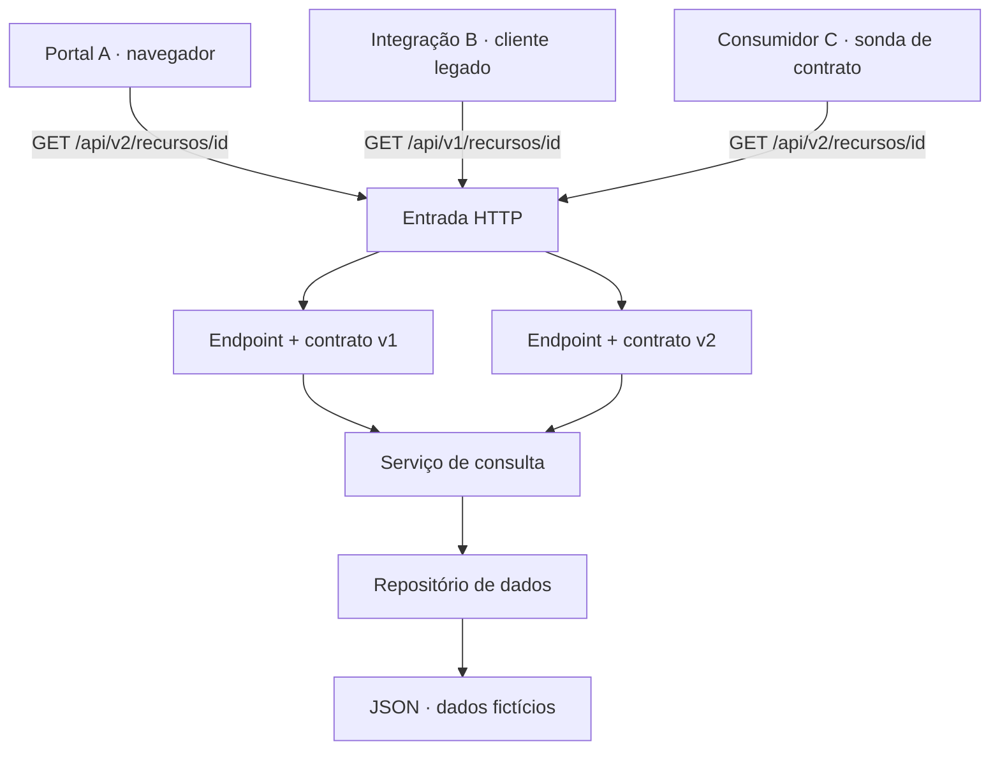

# Arquitetura da solução

As setas representam requisições. As respostas retornam pelo mesmo caminho.

## Responsabilidades

- **Portal A:** frontend que consulta a API v2 e exibe `id`, `nome`, `status`, `unidade` e `responsavel`.
- **Integração B:** programa de terminal que permanece na API v1 e valida exatamente os três campos originais.
- **Consumidor C:** sonda de contrato que consulta a API v2 e valida os cinco campos.
- **Entrada HTTP:** encaminha as requisições para a interface correspondente.
- **Contratos:** definem os campos expostos em cada versão da API.
- **Serviço e repositório:** consultam os mesmos registros armazenados no JSON fictício.

## Evolução do contrato

A API v1 preserva o formato original de três campos. A API v2 acrescenta `unidade` e `responsavel`, sem modificar a resposta da v1. Assim, o consumidor estrito B continua funcionando sem precisar aceitar campos adicionais.

A versão utilizada por cada consumidor deve ser explícita e documentada. Alterar uma resposta compartilhada sem avaliar todos os consumidores pode introduzir uma quebra mesmo quando o código compila e a integração Git é concluída sem conflitos.

## Tratamento de ausência

Nas duas versões, um identificador inexistente em uma rota válida resulta em HTTP 404 e erro estruturado com `erro.codigo = RECURSO_INEXISTENTE` e `erro.id` igual ao identificador solicitado. Uma rota desconhecida utiliza o erro `ROTA_INEXISTENTE`.

## Limites

O ambiente utiliza um servidor HTTP local e arquivos JSON. O exercício verifica contratos, integração, testes e recuperação no Git; não demonstra disponibilidade contínua, deploy sem downtime ou comportamento em infraestrutura de produção.