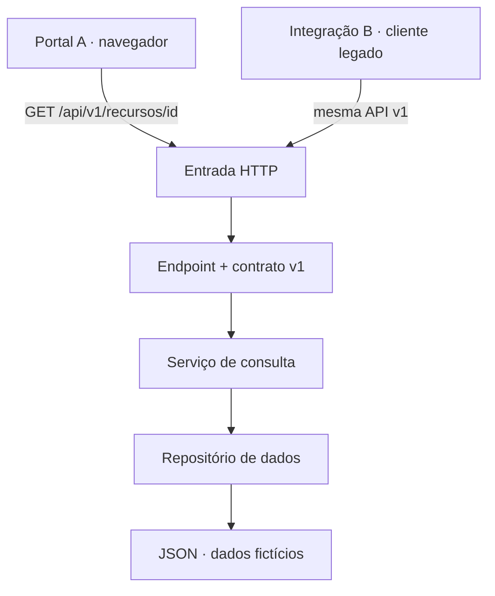
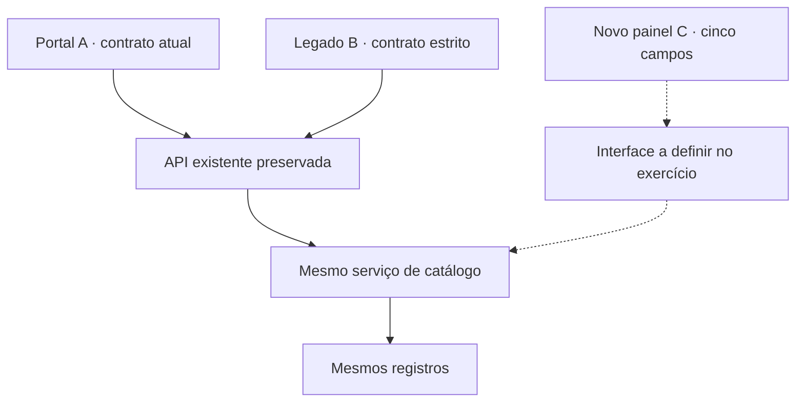

# Arquitetura existente

As setas abaixo mostram requisições/chamadas. As respostas retornam pelo mesmo caminho.

O portal é um frontend funcional. A integração B é um programa de terminal, representando outro sistema consumidor. Ambos consultam o mesmo backend. O JSON já contém cinco campos por registro; a projeção v1 retorna somente três. Não são três livros nem três serviços obrigatoriamente: são três campos em cada resposta de recurso.

## Mudança solicitada

As linhas tracejadas representam o que falta implementar. O painel C é representado por uma sonda de contrato, sem frontend pronto. A decisão de interface é parte da sua resolução.

## Duas entregas simultâneas

A feature amplia a consulta. A correção trata ausência. Ambas passam por `endpoints.py`, mas concorrência não garante conflito textual: o Git pode juntar mudanças que, combinadas, estejam semanticamente erradas. A validação dos resultados é indispensável.
